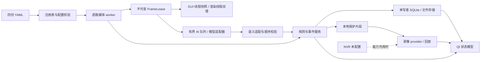

# 接口契约 v1.0.0

本工件为 InterfaceContract，面向当前六路可见光系统的后续实现、集成与验证。架构已可消费；“设计扩展”不表示源码已实现，也不表示目标设备已验证。本次只修改本目录工件与文件清单。

## 1. 依据、范围与兼容决策

源码基线为本次接手时 HEAD `a441939`（桌面实现 `a92d008`）。上游为已验证的 `docs/hmi/INTERACTION_DESIGN.md` v2、`DESKTOP_APP_DESIGN.md` v2、`VISUAL_DESIGN.md`、最新 `release/RELEASE-PACKAGE.md`。需求补充来自 `一些说明和要求.txt`，环境与授权采用本次 Runtime 注入的统一汇总。`truth/interfaces`、`truth/architecture`、`truth/requirements` 本次未列出文件。仓库无 `.codegraph/`，使用限定文件的原生阅读与 rg；未创建索引。

发布报告明确：真实六路 RTSP、真实框/掩码、真实媒体播放/缩略图未纳入发布门。既有 TEST_PASS/RELEASE_READY 保留其原范围，不能外推。设备本轮未连接、未取流、未编译、未部署。

保持 Qt5/QML 本地单进程、core/platform/media/ui 分层、原生 GStreamer UDP、CPU 渲染基线和 SQLite 表结构。这里没有新增 HTTP 服务、消息代理、远程控制通道、列车制动输出或新硬件协议。保留旧 demo CLI，但桌面程序不通过旧 demo 的可选第二路参数实现六路；历史红外、自动重启相机和云机器入口不进入本期接入。

本文件的 MUST/“必须”是后续接入的不变量；“现状”描述实际代码；“设计扩展”是需下游实现的适配边界。JSON Schema 只定义本契约的适配器描述/夹具格式，不替换现有 C++ ABI、YAML 配置或 SQLite 格式，不要求产品新增序列化链路。

## 2. 生产者与消费者

| ID | 生产者 → 消费者 | 现有入口/载荷 | 状态及设计扩展 |
|---|---|---|---|
| IF-01 | 配置目录 → 注册表/各模块 | `load_config_dir`、`ConfigLoadResult`、`CameraConfig` | 已实现；启动完整校验，错误包含字段路径；运行中配置发布待实现 |
| IF-02 | 相机 → media → UI/AI/快照 | `CameraStream::start/pump/stats/stop`、`StreamStats` | 有取流统计；没有向消费者提供图像的公开接口；新增 FrameLease/FrameDescriptor 边界 |
| IF-03 | media → core 状态/设备事件 → UI | `StreamStateMachine`、`drain_events`、`CamRuntime` | 状态机已实现；media 需公开质量/事件及真实重连结果，UI 需动态桥接 |
| IF-04 | media → 推理适配器 → 规则/调试 | `FrameRef`、`Detector::infer`、`DetectionResult`、`AiWorker` | 现有为元数据/模拟调度；新增像素租约、关联键与结果发布 |
| IF-05 | 语义适配器 → `RuleEngine` → 事件服务 | `Detection`、`on_detection/on_device_event`、`AlarmEvent` | 规则已实现；语义映射、结果顺序控制、持久化事件服务待接入 |
| IF-06 | 事件服务/操作 → platform → UI/恢复 | 九表 Row、`SqliteRepository`、`FileStore` | 存储原语已实现；业务事务、确认更新、恢复幂等待接入 |
| IF-07 | 事件服务 → 本地录像/NVR provider → 回放 | `ClipRecorder`、`RecordingSegmentRow`、`ReplayTimeline` | 本地时间戳/清单与回放逻辑已实现；实际媒体与 provider 待实现 |
| IF-08 | GUI ↔ 桥接模型 ↔ 服务 | `railhmiChannels/Alarms/Replay/Maintenance/Permissions/Health` | Qt 桥接已有；main 的实时列表为初始快照，视频层为空 Item |
| IF-09 | 健康/设备适配器 → 状态/维护/AI | `HealthSample`、`PtzState`、IntegrationRow | 业务模型已有；真实设备/采样与动作完成回报待接入 |

## 3. IF-01 配置、摄像头身份与能力

| 稳定 id | position / ai_profile | RTSP 主路径 | 凭据环境变量 | 显示目标 FPS |
|---|---|---|---|---|
| CAM-01 | primary / front | `.65:554/cam/realmonitor?channel=1&subtype=0` | TRAIN_FRONT_RTSP_CREDENTIAL | 25 |
| CAM-02 | left / none | `.160:554/h264/ch1/main/av_stream` | TRAIN_SIDE_RTSP_CREDENTIAL | 15 |
| CAM-03 | right / none | `.162:554/h264/ch1/main/av_stream` | 同上 | 15 |
| CAM-04 | roof / pantograph | `.163:554/h264/ch1/main/av_stream` | 同上 | 15 |
| CAM-05 | underfloor / wheel_rail | `.165:554/h264/ch1/main/av_stream` | 同上 | 15 |
| CAM-06 | cab / cab_door | `.167:554/h264/ch1/main/av_stream` | 同上 | 15 |

地址均为登记的 `192.168.1.x`；完整 URL 从 `app/config/cameras.yaml` 读取，表不是第二份可执行配置。注册表顺序决定 P4 稳定槽位；P1 为 left/primary/right。当前 CAM-06 `ai_enabled=true` 是配置意图，门磁/视觉方案仍未定；不能由该布尔值宣称识别能力。

摄像头全为可见光；左右 ai_enabled=false，其余为 true。`app.mode=visible`、`render_path=cpu`、`recording_source=both`。both 表示来源策略，不证明 NVR 或本地媒体已可用。前/左为文档 H265 1280×720@25；其余四路是待测预期值，正式管线以协商 caps 为准；`display_fps` 是展示上限，不能作为解码实测 FPS。

四份配置必须整体加载；缺文件/非法字段失败，缺省可选项保留 `applied_defaults`。现有枚举和小写 token 继续由 `config.cpp` 解析。设计扩展 ConfigChanged 为“校验成功的完整不可变设置 + 单调递增 revision”；先校验依赖、再交换快照，失败保持原 revision；连接参数改变仅重启受影响通道。当前没有热更新服务，不声称已支持热加载。

凭据只读取登记变量的实际值；不存在/空值返回 CREDENTIAL_MISSING，不能把变量名或 `${...}` 当密码。优先设置 rtspsrc 的认证属性，避免拼接解析串；若适配旧入口，必须正确编码 URI 和 GStreamer 字符串并只在内存中使用。原始凭据、含鉴权 URL、pipeline/bus 原文不得进入日志、DB、工件或进程命令行。`redact_url` 仅处理部分 user:pass@ URL，不能替代对整条错误消息的脱敏。

## 4. 通用字段、时钟和生命周期

设计扩展描述携带 `contract_version=1.0.0`、`origin=live|file|simulation`。simulation 必须由显式输入选择，不能用帧到达、模型名称或编译期宏猜测；生产模式缺能力返回 unavailable，不自动造数据。

跨重连帧身份为 `(session_id,camera_id,generation,seq)`：session_id 是应用启动生成的不透明字符串；generation 每次真正重建通道递增；seq 在该 generation 内严格增加。下游必须拒绝旧 session/generation、重复 seq、乱序结果；状态与时间比较也局限同一 session。持久化不把 core 自增事件 id 当跨启动唯一 id。

| 字段族 | 编码/单位 | 约束与转换 |
|---|---|---|
| `FrameRef.ts_ms` / `Detection.t_ms` / `AlarmEvent.ts_ms` / `StreamEvent.t_ms` | int64 单调毫秒 | 不得直接当 UTC 显示；FrameRef 使用接收时刻 |
| `DetectionResult.ts_ms` | int64 单调毫秒 | 头文件定义结果时刻；SimDetector 实际复制帧时刻，真实适配器须明确改用完成时刻；扩展另存 capture/result 两时刻 |
| `ts_mono_us` | int64 单调微秒 | `TimeBase.steady_now_us()`；传 core 毫秒时整除 1000；不能再当微秒重复乘除 |
| `ts_wall_ms` / 片段与回放 `t0_ms,t1_ms` | int64 UTC epoch 毫秒 | 校准后的 TimeBase 转换；UI 只在显示时采用本机时区 |
| `pts_ns` | uint64 纳秒或 null | 相机/媒体 PTS 可无效且重置，不作主机 UTC 或健康时钟 |
| 距离 / 温度 / 负载 | 米 / 摄氏度 / 百分比 | distance=-1 未知；健康字段 -1 未测，不转 0/正常 |
| FPS / 字节 / 坐标 | 帧每秒 / bytes / 原图归一化 | 计数不等于 FPS；坐标需逆 letterbox，x+w、y+h ≤1 |

启动必须 `TimeBase.calibrate(wall_ms,mono_us)` 后才能持久化带 UTC 的业务事件。公式沿用 `ref_wall_ms + (mono_us-ref_mono_us)/1000`；未校准的退化返回值不能冒充 UTC。重启重新校准；无 GNSS/NTP 实测，不声称跨设备绝对同步。时钟跳变/重新校准记录日志和映射边界，旧事件 UTC 不回写。JSON 数值均为有限数，禁止 NaN/Infinity；C++ id/seq 在 QML double 超过 2^53−1 时以字符串透传，时间毫秒在安全范围内可延续现有 double 方法。

## 5. IF-02 图像与 IF-03 流状态

现状 `CameraStream` 通过 appsink 拉取 NV12、计算亮度后立即 unref sample，公开接口仅 stats。`StreamStats.last_frame_ms=0` 表示无帧，core 内部 -1 表示无帧；桥接时显式处理这两个哨兵。`MultiStreamManager::pump_all` 顺序调用每路 pump，不能在 GUI 线程调用，更不能把它描述为六个独立取流线程。

设计扩展：media 提供 `latest_frame(camera_id)` 获取不可变 FrameLease；空返回 NOT_READY。FrameLease 持有 sample/buffer 的共享所有权或深拷贝，释放回调在最后消费者退出后执行；不能传已 unmap 的裸地址。core 仍仅见 FrameRef 元数据，像素所有权留在 media；真实模型适配入口消费 FrameLease，不能从当前 FrameRef 推导像素。

FrameDescriptor 字段见 schema：camera_id/session_id/generation/seq、capture_mono_us、capture_wall_ms、pts_ns、width/height、format、colorimetry、planes[{offset,stride_bytes,size_bytes}]、buffer_bytes、buffer_ref、memory_kind。buffer_ref 是进程内租约的不透明查找键，不能在进程外解引用；schema 不传指针、fd 或像素。v1 memory_kind=cpu，format=NV12|BGR888|RGB888；GL/DMABUF 日后必须扩充能力协商、同步和线程生命周期，不能塞进 CPU 地址字段。

NV12 必须偶数宽高，两平面 stride≥width，Y 足够 stride×height、UV 足够 stride×height/2；packed 只有一平面且 stride≥width×3，offset+size≤buffer_bytes，平面不重叠。尺寸/stride/colorimetry来自 caps，不能固定连续 width×height。未知色彩元数据标 unknown；优先复用既有 RGA BT601_FULL 基线并验证，若 caps 不同则显式转换/报告，不套用红外灰度或 RGB 均值相等验收。RGA 两个成功码均接受。BGR↔RGB 只在模型输入适配器显式转换，禁止用格式名掩盖通道颠倒。

每路采集在 media worker 有限 pull；显示 latest-only 队列深度 1；AI 按配置深度默认 2 丢最旧；录像从独立有界编码分支获取压缩包，不能复用显示丢帧策略或保存全部原始帧。溢出分别计数，录像溢出记缺口，UI/AI 慢不阻塞取流。

现有状态 token：connecting/live/frozen/offline/reconnecting/degraded。首帧超时 5000ms；live/degraded 无新帧达到 2000ms→frozen；再持续 2000ms→重连；重连退避 1000ms；累计 3 次→offline；新鲜帧恢复清零计数。source_error 可直接触发重连。以上是状态机阈值，不能冒充实际网络重建次数。degraded 有新鲜帧可展示且显式质量提示，其他非实时状态必须占位；唯一依据为 `may_present_as_live(now)`，不能只判断 state==live。

设计扩展 StreamSnapshot 增加质量 flags、最后帧 UTC/单调时间、实际 attempt_id、last_error 脱敏、presentable。状态发布不可把墙钟传入 core tick；presentable 还须租约属于当前 generation。亮度/对比度已有采样，lap_var=-1 未测，不能标为已通过清晰度检查。StreamEvent 由 media drain 到事件服务；freeze/escalated 根据 position 归类一次设备事件，重复由规则抑制。

`CameraStream::pump` / `StreamStateMachine::tick` 本身仍不重建 pipeline，`offline` 也仍是吸收态（第 97 行的状态机阈值不能冒充实际网络重建次数）。现场修复在生产链路补上了真实重建入口：`VideoRuntime::refresh`（GUI 主线程 40ms）为每路维护独立**看门狗**，按 `CameraStream::now_ms()` 单调时钟与 `StreamStats.last_frame_ms` 判定，超过 `kRebuildNoFrameMs=8000ms` 没有新帧即调用 `MultiStreamManager::request_restart(i)`，由该路 worker 线程执行 `stop(NULL/释放) → start(重建)`，generation+1、seq 归零。不依赖 `last_error` 文本：11-13 板端 6 小时长跑日志（`hmi_live.log`，409MB）显示 `frozen` 35 次、`reconnecting` 25 次、`offline` 4 次，而非 RGA 的 GStreamer 错误只有 4 条 `gst_event_set_seqnum` CRITICAL，**没有 rtspsrc timeout/EOS/401**，即六路 UDP 的断流基本是静默停帧；只靠错误分类驱动的 `RecoveryController`（原本只被 `tools/*probe.cpp` 使用）既不会触发，也不适合无人值守（max_attempts=5 后 stopped、awaiting_recovery 期间跳过 policy tick），故不复用它做生产重连。看门狗按退避 `5000ms` 起指数增长、上限 `60000ms`，**不设总次数上限**；只有真实新帧（`last_frame_ms` 变化）才复位退避并顺延截止时间，恢复确认不采信 PLAYING 返回值。`core::classify_source_error` 判为 AUTH_FAILED / CREDENTIAL_MISSING / UNSUPPORTED / FORMAT 的路只低频复核、不自动反复重建（§10 凭据缺失不静默重试）；`manager().started(i)==false` 的启动失败路不参与重建，保留显式失败文案。每次重建打 `video watchdog: rebuild` 审计日志（camera/stalled_ms/attempt/backoff/last_error 脱敏）。单路失败不得重排槽位或重启其他五路。UI 侧 `presentable=false` 仍主动清空最后一帧、不把过期帧冒充实时，靠缩短重建时间减少黑屏窗口。**板端验收已完成（11-14）**：`iptables` 屏蔽 CAM-06 的 RTSP 源 `192.168.1.167` 入向包 32s，看门狗独立打印 `rebuild "CAM-06" stalled_ms=8056 attempt=1 backoff_ms=5000` 与 `attempt=2 backoff_ms=10000`，其余五路无 rebuild；解除屏蔽后 CAM-06 自行回到 `live presentable=true`，恢复后 80s 内不再重建，QML 运行期错误 0 行。另一次启动首帧失败也由看门狗自动救回（`rebuild "CAM-05" ... last_error="Could not read from resource."` → 六路最终全部 `live presentable=true`）。`hmi_verify/stream_multi_drop_verify.sh` 同时屏蔽 CAM-05/CAM-06 两路 30s，两路各自按 `5000→10000ms` 独立退避重建（其余四路 rebuild 数 0），解除后 15s 内双双回到 `live presentable=true`，随后 60s 无新增重建、QML 运行期错误 0 行。日志里仍存在 librga `RGA_BLIT fail: Invalid argument` 的间歇性失败与大量转储输出，属 NV12→BGR 转换层独立问题，表现为偶发单帧丢失/日志膨胀，不是持续断流的主因，未纳入本次重连改动。

本次执行的相机采集入口无授权，以下是下游调用边界：沿登记 RK3588 入口使用 UDP、只选择视频 RTP pad，忽略音频，不自动改 TCP/路径。元数据探测上限 20s、一次采集上限 30s；SSH 收尾不超过登记 timeout。产品单次 pull 默认≤200ms，GUI 不等待；start/重连/stop/infer 必须有调用方 deadline 与完成回报。若底层不可取消，保留资源所有权并上报超时，不能 detach/释放仍在用的内存；需要进程隔离时先补生命周期设计，不能谎报已停止。

## 6. IF-04 推理与 IF-05 语义/报警

现有 `DetectionBox` 为 x/y/w/h/confidence/class_id/label/in_roi/distance_m；`DetectionResult` 为 camera_id/profile/ts_ms/latency_ms/model_version/boxes/max_confidence，无 seq、mask、状态或跟踪 ID。`Detector.ready()` 只表达全局就绪，不表达各职责能力。`AiWorker.tick()` 当前自造帧元数据、未调用 `plan_inference`、不保存/发布 DetectionResult；虽然存在 submit/snapshot，也不能视为真实取流→规则已接通。真实路径必须关闭合成 tick，发布结果并按职责检查模型能力。

设计扩展 InferenceEnvelope 关联同一 FrameDescriptor 身份，包含 profile、capture_mono_us/result_mono_us、latency_ms（完成减接收，包含排队）、model_version、availability（ready|unavailable）、reason、boxes。每 box 在旧字段之外带 track_id（int32 或 null）；mask 以原图坐标的独立二值 plane 租约交接，像素 0/非零，尺寸/stride/所有权规则同帧，不把 RGB 掩码当 bool。mask 不经当前 core DetectionResult；语义适配器消费它后再生成 Detection。没有模型或结果时 unavailable+reason+空 boxes，不可用空框冒充已检测安全。

front 两阶段：复用轨道分割与人员检测，在原图逆变换后用人员框中心是否在 rail mask 判定；需要配置 danger_zone 时再与该 ROI 求交。分割和检测必须来自同帧同 generation；若复用缓存，需实现并登记最大年龄和失配策略，未配置禁止将跨帧缓存作为实时报警依据。分割失败不能退化成轨道内“安全”。现有分割文档输入 640×640 NHWC INT8、13 输出，后处理 `for (i<13)`；真实加载必须查询 tensor 数量、形状、布局、量化并匹配后处理后才 ready，不能只按文件名判断。

既有 yolov5s 仅 COCO person；轨道分割不等于轮轨脱离识别；相同模型挂到 pantograph/cab_door 不会获得语义能力。职责能力需适配器声明并核验，模型版本字符串仅身份。障碍物/树枝/碎石、受电弓三态、轮轨、车门专用语义未获现有模型证据；未支持时该职责 unavailable。测距未标定时 distance_m=-1，不用检测框尺寸臆造米值；`danger_proximity_m` 当前规则并未消费，不能写成已实施的 5m 风险门槛。

语义映射必须严格：front 只把支持的 person/obstacle 传 RuleEngine；未知 label 被拦截（当前规则会把非 person 都归障碍）。pantograph 传 unknown/not_raised/normal/abnormal；wheel_rail 传经标定语义的 wheel_abnormal；cab_door 传 unknown/closed/ajar。左右 none 永不产生检测类报警。unknown 不映射到正常。跟踪未就绪时 frame track_id=null；不能直接把所有目标映射 track_id=0 累计三次误认同一目标，须提供跟踪或显式的已验证相机级事件适配。

规则保留现有级别：person_on_rail/front_obstacle/wheel_derail=L1；pantograph_abnormal/door_ajar/front_camera_device/device=L2；side_camera_device=L3。on_detection 按 `(camera,type,track_id)` 抑制，默认 3 次确认，相邻命中间隔≤500ms，抑制窗口 `<3000ms`。注意现有实现判断相邻间隔而不是三帧总跨度；0/400/800ms 会确认，这一语义原样记录，若需求要求总窗须交实现修复后版本化，不在本次架构悄改。

每次命中只处理一次；同帧多目标先聚合并按稳定 track 排序，不能让无关非候选调用任意清除同相机确认（现有 reset_camera_confirm 清除整路）。失帧/新 generation 清理确认与跟踪；现有 RuleEngine 无公开 reset，需实现者补受控接口。抑制期间 on_detection 返回空但会更新已有事件元数据，事件服务需同步变化，不能仅消费新返回数组。确认仅 ack_state，不删事件，不重置故障/AI 可用性。

推理默认每 5 帧，front>wheel_rail>pantograph>cab_door，npu_budget=4 是调度路数预算而非 NPU 核数或通过的算力容量；85°C 热守卫由 scheduler 定义，真实工作线程须接入决策与实测温度，不能拿模拟 FPS/温度冒充能力。真实 infer 不得持调度锁阻塞 submit/状态快照/stop；结果队列有界，超载显式丢旧并发布计数。AI 不可用不影响视频显示。

## 7. IF-06 事件、数据库和文件一致性

沿用九表 `events,event_targets,maintenance_log,device_health,recording_segments,recording_gaps,stream_events,integrations,config_kv`；Row 字段以 `persistence_model.h` 为准，不在本次改 DDL。EventRow 保留 level/type/source_cam/ai_profile、UTC毫秒/单调微秒、confidence/distance_m/algo/model_version/description/ack_state/record_available/snapshot_ref。EventTargetRow 的 first_ts/last_ts 本契约适配层统一写 UTC毫秒，boxes_json 用原图归一化框；现有历史数据无显式单位者不猜测迁移。

事件服务是唯一业务写入口，单写线程持有 SqliteRepository；现有 open 使用 WAL、foreign_keys=ON、synchronous=NORMAL、busy_timeout=5000ms。DB 操作不得在 GUI 线程阻塞。insert 返回 -1 或 bool=false 时必须保留错误，不能当空结果。SQLite rowid 为正式事件 id；core AlarmEvent.id 只在本次引擎实例有效，适配层保存 engine→DB id 映射。事件与目标写同一事务；确认与审计同一事务，ack 重试幂等。当前 Repository 缺事件更新/ack/列表查询和业务事务 API，列为下游实现依赖，不能称已持久确认。

写前按采集时刻校准 UTC；algo/model_version/ai_profile 来自实际结果来源，不能用配置名称覆盖运行时模型身份。现有 stream 单调 ms 需乘 1000 转 ts_mono_us，再经已校准 TimeBase 转 UTC。跨进程恢复只依据 UTC 查询，不跨启动比较 ts_mono_us。

文件先写同目录临时文件，再完成媒体封装/校验、flush+fsync 文件、rename、fsync 目录，然后事务发布可用索引。现有 FileStore 只有 ofstream.flush+rename，没有 fsync；SQLite NORMAL 也不保证最近事务抗断电，本次不声称断电持久性已通过。文件失败不置 record_available=true；索引失败保留可恢复孤儿及日志，启动核对临时文件/孤儿/缺失文件，缺失写 gap 或 unavailable。存储重试最多在剩余 deadline 内有限次数，不能无界内存堆积或吞错。

保留策略遵循现有普通片段先淘汰、必要时最旧保护片段仍可淘汰；保护不是永不删除。容量 max_gb 与实际 free bytes 分开，换算口径实现前固定并登记，不把 max_gb 当磁盘可用；低空间阻止新写并报警，事件元数据/缺口尽可能保留。删除/失败同步更新片段索引和事件录像可用性，不能残留播放成功标记。

## 8. IF-07 录像、回放与 NVR

设计扩展 ClipRequest：request_id/event_id/camera_id/trigger_wall_ms/t0_wall_ms/t1_wall_ms，其中 t0=trigger−pre×1000、t1=trigger+post×1000；默认 −30s/+60s，来源为 thresholds.yaml。event_id 是已提交 DB id；request_id 是幂等键，相同键不同参数 CONFLICT，重复相同请求返回同一作业。前方事件请求相关 left/primary/right 三路（各路独立报告缺口），其他事件请求来源路；六路预缓冲与写盘量需实测，不能由时间戳 buffer 推断存在媒体。

内部实际媒体区间采用 `[t0,t1)`；RollingBuffer.count_in 现有闭区间保留在逻辑模型中，适配时边界只映射一次，避免拼接重复末帧。压缩流以关键帧解码依赖决定实际起点，回报 actual_t0/actual_t1 与请求窗口；不得用期望的 90s 覆盖缺失前录/后录。缺口按 camera/time/reason 存储；部分可播放标 Incomplete，无片段标 Unavailable。现有 bool record_available 仅兼容完整可用 true，不足表达三态；UI 使用 RecordAvailability 和片段/gap 联合推导。当前 P2 的 camera级 record map 需升级为事件时间窗级计算，不能因为同路其他录像存在而误标所有事件。

现状 ClipRecorder 只存时间戳、生成 JSON 清单/估算大小，finalize 不证明 MP4/TS 可解码。provider 必须以真实可读/可定位/可解码媒体和实际覆盖范围返回 usable。禁止把 .json 清单、空文件、路径存在或估算 size_bytes 当录像。

IRecordingProvider 设计扩展保持上游方法族：querySegments(camera,t0,t1)、queryGaps、playSegment、exportSegment。每次带 request_id 与 deadline_mono_us，返回 status=ok|partial|unavailable|error、reason、segments、gaps，不可用原因区分 UNCONFIGURED/UNVERIFIED/NOT_FOUND/AUTH_FAILED/TIMEOUT/UNSUPPORTED/STORAGE_ERROR。ok 空列表仅表示查询成功无覆盖，不能声称可播放。play/seek 是异步请求，回报实际 decoded position；请求接受不等于播放成功。导出返回实际完成路径/大小或失败，部分覆盖需显式 partial。

NVR 登记地址 `.4`，协议/账户/六路映射/管理入口缺失：state=unconfigured、query 返回 unavailable/UNCONFIGURED；不探测未知协议、不猜通道号、不修改 NVR。将来实现 NvrProvider 前补环境登记与授权、厂商协议/鉴权/时间轴及通道映射；架构只定义抽象。`reachable` 仅网络可达，不能等价回放支持。NVR 不可用时仅在本地对应窗口有真实片段才回退，否则 unavailable；不生成模拟片段填补。

P3 保留 selectAlarm(camera_id,ts_wall_ms)、relatedCameras、timeline(camera,date)、四跳转、playback/setPlaying/setSpeed、sourceStatus、syncState。selectAlarm 在未来增加 event_id 的非破坏重载，旧 camera+ts 遇多事件须明确歧义。前方默认左/前/右；时间轴 UTC、日期显示按本机时区且标明转换，不能混用 UTC日与本地日。

同步按各路实际解码播放头的统一 UTC 时间求 max−min，超过 300ms（可配）提示；缺任一路有效时钟 available=false。现有 setCameraOffsets 是模型注入接口，不能以固定 offsets 代替真实播放头。用户 seek 递增 request generation，丢弃旧完成回调；position 未到达不能提前显示“已定位”。缩略图只用媒体生成的可读引用；thumbSource 缺基址继续返回空，不编造 URL。

现场定稿（P3 历史录像页精简，无键盘现场）：账号/密码/「登录摄像机」行、「连接摄像机 / NVR 通道 / 查询录像」行整行删除。只有一个 NVR，`nvr.yaml` 固定账号与六路通道映射，密码来自部署私有 `nvr-credentials.env`（键名由 `credential_env` 指定）；启动时 `RailhmiReplayModel::configureNvr` 在接好 `channelsReady/recordsReady/playbackReady/failed` 之后 `setCredentials` + `refreshNvrChannels` 自动登录并读取设备实际通道，右侧通道列表改为只读展示，页面不允许改写通道号。凭据缺失保持显式失败文案（CREDENTIAL_MISSING），不伪装成已连接、不静默重试（§10）。`main.cpp` 在 `configureNvr` 之前调 `loadPrivateCredentialFiles`：现场显式注入的环境变量优先，私有文件只补齐缺失项；systemd 登记两份 `EnvironmentFile`（`-` 前缀表示可选）。日期不再用 `TextInput.onEditingFinished`（现场没有物理键盘/回车键），改为可见「查询」按钮触发 `applyDate()`；点击日期框弹应用内 `VirtualKeyboard`（板端无 Qt VirtualKeyboard QML 模块），点页面空白处收起，键盘「完成」等价于查询。倍速 `0.5×/1×/2×` 与导出录像入口/二次确认全部移除：倍速未实现，导出由 NVR 侧完成；保留已实现的播放/暂停与 `-30s / 报警时刻 / +30s / +60s` 四跳转。`core::export_recording` 与权限矩阵门禁仍在桥接层保留供其它受控动作，不因 UI 移除入口而删除。

## 9. IF-08 Qt 桥接与 IF-09 维护/健康

保持现有上下文名与 QVariantMap camelCase；core snake_case 只在桥接层转换。railhmiChannels 每格键保持 id/name/position/badge/aiEnabled/slot/state/stateLabel/fpsText/lastFrameText/reconnectText/presentable/placeholder；aiDebug 保持 cameraId/profile/modelVersion/available/unavailableReason/fpsText/latencyMs/lastResultText/confidenceText/distanceText/boxes/roi。DetectionBox.distance_m→distanceM；数值未知值不格式化为0。

设计扩展由 QObject/QAbstractListModel 在 GUI 线程更新快照与 notify，worker 通过 queued connection 送不可变消息；纹理创建/销毁在 Qt 渲染线程；模型更新不能在每次取帧无限追加信号，可合并 latest。P1/P4/P5 共享同一帧来源与状态真值，切页不另拉流/不重置媒体服务；P1 司机不显示 AI 调试叠加与检测徽标，P5 权限由 core 控制。保留既有 changed/selectionChanged/playbackChanged 信号语义，运行时刷新需实际接线。

动作边界在服务端重新调用现有 permissions gate，不依赖 QML 隐藏按钮。exportRecording/modifyConfig/PTZ 等敏感动作需权限+二次确认+审计，再发真实请求。设计扩展 ActionReply 区分 accepted/completed/failed、request_id、reason；accepted 不能当 completed，超时 unknown 需先查状态不能盲目重试副作用。confirm 仅用户交互凭据，不是设备执行成功；角色配置不是新增鉴权系统。本能力不实现登录或改变权限矩阵。

PTZ 模型 PtzState/容差与 ptzAction/reconnect 保留；现有 action 只是模型/日志，不是设备命令。可支持的 HTTP/ONVIF 地址、鉴权、Pan/Tilt单位/量程、zoom比例、home/preset token、实际位置查询及完成标准需由当前设备协议证据补齐；历史脚本只作参考，无活动入口时返回 UNSUPPORTED/UNCONFIGURED，不猜0..1/角度单位。前方 AI 必须基于有效实际值/容差检查才就绪，不能用 target填actual；未知/超差显示 NOT_READY。自动重启相机不是本期默认恢复行为。

health 采样声明 npu/cpu 为0..100百分比、temp_c摄氏、disk bytes、net_errors累计计数；读不到用-1或明确 unavailable，不填固定演示值。main 当前无条件 seed 健康样例与成功恢复序列，即使 simulation=false；真实接入必须改用采样/真实步骤结果，不能拿其“正常”当设备通过。车速/GPS、声音输出未提供协议/设备事实，保留未接入；不新增接线、串口/CAN或蜂鸣器指令。

门磁已由仓库根目录两份厂商资料补齐协议与设备事实（USTONE-HA-BSM1-DG / -UM v0.1，产品型号 BWD1）：31 字节 BLE 广播帧，byte0=0x07、byte1..4=设备ID(小端)、byte5..30 为 `<Key,Value>`，Key 0x08 门磁(1B，1=感应不到磁铁即未关严)、Key 0x63 电池百分比(2B 小端)；广播名 T1；无 GATT 服务/特征值与配对流程。生产实现分两层：主路径为 HCI 原始通道直读——`DoorSensorWorker` 在独立 `QThread` 中打开 `HCI_CHANNEL_RAW` 套接字，下发 `LE Set Scan Enable(filter_dup=0)`，用 `QSocketNotifier` 读取 `LE Advertising Report`，解析 `company=0xFF07` 的厂商 AD structure；次路径（无 `CAP_NET_ADMIN+CAP_NET_RAW` 时降级）为 Qt5::DBus 读 `org.bluez` 的 `ObjectManager.GetManagedObjects` / `Adapter1.StartDiscovery`，从 `Device1.ManufacturerData(a{qv})` / `ServiceData(a{sv})` 取广播字节。纯逻辑在 `core::parse_door_frame` / `summarize_door_sensors` 解析；`app.door_sensor` 为可选配置节（缺省记录 `applied_defaults`）。只做发现过滤（广播名或已登记 MAC，说明书截图 MAC 不得预置为真实设备）、不连接/不配对/不写特征值；稳定 reason token 为 UNCONFIGURED/NOT_READY/SOURCE_ERROR/UNSUPPORTED/UNVERIFIED/STALE，未核验/格式不符/过期/BlueZ 失败一律 unavailable，不按「门已关」默认；仅「非未关严→未关严」跃迁追加一条 L2 `door_ajar` 事件。不带门磁 Key 0x08 的后续广播（电池帧、纯 RSSI 更新）只更新新鲜度与电量，不覆盖上一次已核验的门状态，也不得把设备打回未核验；超时后重新收到广播则清除 STALE。合成帧只能由显式环境变量 `RAILHMI_DOOR_SIM_FRAME` 注入且日志与界面标注 `simulation`，不得冒充真实设备；后续帧回归另用 `RAILHMI_DOOR_SIM_FOLLOWUP` / `RAILHMI_DOOR_SIM_FOLLOWUP_MS`，同样仅验证用并显式打印 SYNTHETIC。

现场实测补充（RK3588 / BlueZ 5.64，真实 BWD1，MAC `C0:6D:9A:AC:C3:87`，广播名 T1，RSSI 约 -50~-66 dBm，广播间隔厂家标称 1s）：只调 `StartDiscovery` 时 BlueZ 默认去重与临时对象清理会让该设备在 `GetManagedObjects` 里几乎不出现（底层 `btmon` 却能收到 `Name (short): T1`）；必须先 `Adapter1.SetDiscoveryFilter({Transport:"le", DuplicateData:true})` 再 `StartDiscovery`，设备对象才稳定可见。31B ADV data 中厂商 AD structure 为 `1A FF | 07 FF | FF FF FF 06 00 63 62 00 ... <计数>`，即 `ManufacturerData` 的 company=`0xFF07`、value=23B，**PDF 的 0x07 帧首被 BlueZ 当作 company id 低字节剥离**，且 `<Key,Value>` 报文前还有少量固件头部字节。运行时仅为该 company 生成「company 小端 + value」的拼接候选，并对该候选启用 `DoorFrameFormat::vendor_tolerant`（有限窗口内跳过头部定位第一个合法 Key，超出窗口立即停止）；其它厂商数据不生成候选、不得误判为门磁。磁铁状态实测对比：贴合时厂商 value 为 `FF FF FF 06 00 63 62 00 ...`，分开时为 `FF FF FF 06 01 63 62 00 ...`，**唯一状态位是 `0x06` 后的 1B 布尔值**（0=感应到磁铁/关闭，1=感应不到/未关严），且每次广播都携带；PDF 标注的门磁 Key `0x08` 与「状态变化立即上报」均与现场固件不符。解析器保留 `0x08` 兼容文档，另在 `vendor_tolerant` 的已确认厂商帧中识别 `0x06`（Value 必须为 0/1，否则不判门态），因此开门后一个广播周期内即可产生 L2 `door_ajar` 报警；若确实未收到可核验广播，门状态保持 Unknown 并按 unavailable 汇总，不得臆测为已关闭。读取节奏：主路径为 HCI 原始通道事件驱动（`QSocketNotifier`），40s 内可收到 151 次 `pushedFrame`，状态变化 1~2s 内被识别；降级路径为 1s `GetManagedObjects` 轮询 + 正确接口 `org.freedesktop.DBus.Properties` 的 `PropertiesChanged` 订阅。`stale_ms`（默认 60000ms）判定广播超时。实机闭环验收：磁铁分开时 `decoded vendor frame ... 06 01 ... door=ajar` → `snapshot level=alarm value='1 路未关严'`，P1 顶栏/报警栏、P6 门磁卡片、P2 L2 `door_ajar` 事件同步置警；磁铁贴合时 `... 06 00 ... door=closed` → `snapshot level=ok value='全关'`，报警栏恢复「当前报警：无」。

桥接层时间显示遵循 §4：`ts_wall_ms` 始终是 UTC epoch，`core::format_time_text` / `parse_date_utc_ms` 保持纯 UTC 语义不变；`RailhmiAlarmModel::rowToVariant` 与 `RailhmiReplayModel::formatTime`（未配置 NVR 时区时）改用 `QDateTime(..., Qt::LocalTime)` 按本机时区显示，报警中心的日期过滤把「本机日界」经 `QDateTime(QDate,QTime(0,0),Qt::LocalTime).toMSecsSinceEpoch()` 换算回 UTC epoch 再交给 core，避免 UTC 日与本地日混用。此前实时门磁事件在 Asia/Shanghai 板上显示为 UTC（比顶栏时钟少 8 小时），已修正。

顶栏（现场需求定稿）：顺序固定为 `time / camera / recording / health / vehicle_state / door_sensor`，由 `core::build_top_bar` 单一来源生成，删除 `mode`（可见光·红外未接入）与 `ai`，把 `vehicle_speed` 换成 `车辆状态`。四项真值映射集中在 `core`：`camera_top_status(live,total)` 用 `VideoChannel.info.presentable` 计数显示 `x/N 路实时`（全部在线 ok / 部分 warning / 全离线 alarm / total<=0 未接入）；`nvr_top_status(bool)` 只认真实连接探测结果，显示 `NVR正常/NVR异常`；`door_top_status(level_token)` 把 BLE 汇总映射成 `开门/关门/传感器异常`（`ok` 才关门，`alarm` 开门，其余含 unavailable/warning/info/空一律传感器异常，绝不把未知当关门）；`vehicle_state_top_status(mode)` 为 0=未接入/1=静止/2=运动。车辆状态没有车速/GPS/轴速数据源，按契约不得臆测，因此由 `VehicleStateRuntime` 做**人工置位**：点击顶栏该项在 未接入→静止→运动 间循环，界面标注「人工置位」，不伪装成传感器真值。系统健康仍无真实采样源，保持「未接入」。

录像位连接探测边界：`NvrStatusRuntime` 每次按 `nvr.yaml` 的 `address` 取 host/port 做真实 TCP `connectToHost`（启动 1.5s 首探，之后每 15s 复核，单次 3s 超时），成功即 `NVR正常`，拒绝/超时/地址无效/未启用/配置损坏一律 `NVR异常`；只在跃迁时发信号与打日志，不写任何业务请求、不登录/查询/修改 NVR，也不复用 P3 的 `NvrClient`，避免与回放页状态互相污染。**该位证明的是链路可达，不等于回放能力或录像完整性**（§8 的 `reachable` 不能等价回放支持仍然成立）；未探测到连接前绝不显示 `NVR正常`。

P1 布局与摄像头放大交互：P1 在原有「前方大画面 + 左/右侧视」之下新增底部行，放两格较小的 16:9 实时画面（`roof` 受电弓 / `underfloor` 轮轨，`fillMode=1` Cover），「当前报警」从通栏收进两格后面的框内。现场追加调整：原 P1 中部「关键状态区」七项（受电弓/轮轨/车门/摄像头/AI/录像/存储）与外壳顶部状态条信息重复，已整行删除；`P1Realtime.qml` 不再声明 `statusNavigate`，`main.qml` 的可选连接对其自然跳过，其它页面不受影响。释放的垂直高度由底部行吸收（行高按两格三等分宽度反推 16:9 且不超过屏高 30%），主三联仍严格 16:9、`videoBlock` 居中，不出现上下大片留白。C++ 侧 `railhmiKeyStatus` 上下文属性与 `core::build_key_status` 保留（探针/其它消费方仍可用），只是 P1 不再渲染该项。P1 与 P4 的每个摄像头格都发 `activated` 信号，页面以 `zoomRequested(channel,...)` 交给外壳层的 `CameraZoomOverlay`：浮层是同一 `VideoChannel` 的第二个 `VideoFrame` 渲染面（latest-only 快照，不重新取流、不改槽位顺序），放大窗口自身严格 16:9 且用 Fit 不裁剪；遮罩覆盖全屏，点击窗口外任何空白区域关闭，`Timer(60000)` 1 分钟自动关闭，切页时主动关闭。浮层内部点击不关闭，避免误触。P1 中部关键状态区已按后续现场要求整行删除（见下段）；顶栏录像位仍只表示 NVR **链路可达**，不等于回放能力或录像完整性。

现场定稿（P2 报警中心筛选与日期）：第二行「全部类型 / 类型 / 全部摄像头 / 摄像头」改为**互斥单选**，唯一选中态 `fCategory`（`all_type` / `all_camera` / `type:<token>` / `camera:<id>`），全部 chip 经 `selectCategory(key)` 先清空 `fType`/`fCamera` 再置当前维度并重新查询，界面永远只高亮一个，不允许类型与摄像头同时生效。日期「从/至」给可见默认值：起点为 30 天前、终点为本机当天（`Qt.formatDate(new Date(...),"yyyy-MM-dd")`），避免只查当天把已有历史事件滤成空列表（现场已有报警多为前一日产生）；由可见「查询」按钮 `applyDates()` 提交，点击日期弹与 P3 共用的应用内 `VirtualKeyboard`，点空白处收起，键盘「完成」等价于查询；不再依赖回车键，`清除筛选` 也把日期复位到同一 30 天窗口。日期过滤仍按 §4/§7 把本机日界换算回 UTC epoch 后交给 core，默认值只是 UI 初值，不改变 `ts_wall_ms` 的 UTC 语义。虚拟键盘为全键盘（数字行含 `-`、字母三行、清空/空格/退格/完成），只操作目标 `TextInput` 的文本与光标，不依赖系统输入法、不新增 QML 模块依赖；键盘面板自身吃掉点击，避免按键误触发页面空白收起。静态守卫 `check_alarm_center_wiring.py` 固化单选/默认值/查询/键盘/无硬编码色值约束，`check_replay_wiring.py` 与 `check_permissions_wiring.py` 把倍速与导出改为「必须不存在」的反向断言。

交互回归修正（11-14 板端实机发现并修复）：「点空白收起键盘」原先只放在页面最底层 `MouseArea`，P2 无报警行时可收起，但**一旦有报警行，铺满内容区的 `ListView`（Flickable）会吞掉空白点击，键盘收不起**。现改为共享 `VirtualKeyboard` 根节点 `anchors.fill: parent` 且保持 `z=modal`，在键盘面板下增加全页 `virtualKeyboardScrim`：`propagateComposedEvents: true` + `mouse.accepted = false`，点面板外任意位置都收起，同时把点击继续传给下层 chip/按钮，不需要「先点一下关键盘、再点按钮」；键盘面板自身的 `MouseArea` 仍吃掉按键点击。P2/P3 页面底层的 `alarmDismissKeyboard` / `replayDismissKeyboard` 保留作兜底。守卫 `check_alarm_center_wiring.py` / `check_replay_wiring.py` 增加 `virtualKeyboardScrim` 与 `propagateComposedEvents: true` 的必须存在断言。板端 `hmi_verify/round3_interactive.sh` 用 Xvfb 合成开门帧造出真实报警行后复验：有行时点空白可收起、开着键盘点「一级」能同时收起并切中筛选、单选链 `全部类型→车门未关严→全部摄像头→门磁` 每次只有一个 chip 高亮，QML 运行期错误 0 行。

板端验收（2026-11-13，RK3588 `1280x800@60Hz`，`DISPLAY=:0` 真屏 + 六路实时 RTSP）：三项静态守卫、五页接线守卫（22 QML / 53 头文件）、核心测试 `1504 passed, 0 failed`、`railhmi-status-probe --scenario mixed` 新 6 项顶栏 PASS，全量 Qt 目标构建成功。`RAILHMI_DUMP_LAYOUT=1` 几何自检：P1 `bottomRow=1160x165`、`tilePantograph/tileWheelRail=294x165`（16:9）、`alarmBar=547x165`、`statusStrip=1160x64`、三联 `793x446` + `386x217 x2`（16:9）。运行日志 `door-sensor: enabled ... poll=10000ms`，`scan objects` 时间戳 10:53:44 / 10:53:54 / 10:54:04 / 10:54:14 / 10:54:24，确证最多每 10s 读一次；`nvr-status: 192.168.1.4:80 -> NVR正常 (tcp connected)`；六路 `presentable=true`；累计 QML 运行期错误 0。真值截图：常态顶栏「6/6 路实时 / NVR正常 / 未接入·点击切换 / 关门」；临时配置把 NVR 指向关闭端口并禁用门磁 → 「0/6 路实时 / NVR异常 / 传感器异常」；注入显式 `SYNTHETIC` 开门帧 → 顶栏「门磁 开门」+ 报警框「车门未关严（1 路）」。人工置位三击日志 `mode=1 → 2 → 0`，界面「静止/运动 · 人工置位」→「未接入 · 点击切换」。交互：P1 前方/受电弓/轮轨格、P4 CAM-01/CAM-06 格均能弹出单路放大浮层（标题分别为「车头前方 / 车顶受电弓 / 车底轮轨 / 司机室车门 · 实时」）；点遮罩关闭、点窗口内部不关闭，t0/t30 浮层仍在、t63 已自动消失。证据脚本 `hmi_verify/ui_round_verify.sh`、`hmi_verify/ui_round_states_verify.sh`，截图 `hmi_verify/round2/ROUND2_*.png`。

现场三轮（11-16）：P3 回放画面改为整页可用区域最大化，右侧「时间/类型/级别/距离/置信度/处理状态/备注」详情栏与只读通道列表整栏删除（该信息由 NVR 侧 / 顶部摄像头选择替代），回放面板严格 16:9 且 `VideoFrame.fillMode=1`（Cover）消除巨幅黑边；空关键帧条 `visible: thumbs.length > 0` 不再占位，底部只留游标时间/时间轴/播放与四跳转。`check_replay_wiring.py` 加入 `panelH * 16 / 9`、`fillMode: 1`、`videoArea` 正向断言与详情字段反向断言。P2 报警中心类型筛选不再由当前报警行动态生成，固定写死 `全部类型 / 摄像头 / 门磁 / NVR / 主机` 五个互斥单选 chip；类别真值由 `core::alarm_category(AlarmRow)` 派生（`door_ajar`→door、NVR 来源→nvr、`AlarmType::Device`→host、其余→camera），`AlarmFilter.has_category/category` 与 `RailhmiAlarmModel::query(..., category)` 落地过滤；`NVR/主机` 当前无事件生产者时如实显示空态，不伪造事件。`check_alarm_center_wiring.py` 要求五个 chip 固定存在并禁止 `model.options()` 动态模型。

顶栏资源读数（11-16）与门磁 HCI 原始通道（11-17）：新增 `SystemMetricsRuntime`（Qt 定时器 2s）+ `ResourceMeters.qml`，在顶栏右侧两行紧凑显示 **内存占用率 + 每个 CPU 核占用率 + 每个 NPU 核占用率**。真值口径：内存 `(MemTotal-MemAvailable)/MemTotal` 读 `/proc/meminfo`；逐核 CPU 用 `/proc/stat` 相邻两次 `cpuN` 的 busy/total 差值（RK3588 实测 8 核）；逐核 NPU 读 `/sys/kernel/debug/rknpu/load` 的 `Core0/1/2`（实测 `NPU load: Core0: 0%, Core1: 0%, Core2: 0%,`）。debugfs 不可读时退到 `/sys/class/devfreq/fdab0000.npu/load` 的**聚合**值并显式标注「聚合」，绝不把单值复制成三个核；两者都不可读显示「未接入」；任何维度取不到填 `-1` 显示「—」，绝不填 0 冒充正常。左侧六个状态项 `anchors.right` 绑定到读数左侧，1280 宽不重叠。守卫 `check_runtime_resources_wiring.py`（R-01..R-07）核对采样源、聚合标注、装配、主题，以及门磁 HCI 原始直读 + BlueZ 降级路径。

门磁加速（11-16，回答「是不是多线程 / 反应太慢」）：**改造前不是多线程**——所有 BlueZ 调用都在 GUI 线程以 `QDBusConnection::call(..., QDBus::Block, 3000)` 同步执行，且 `PropertiesChanged` 订阅的 interface 写成了不存在的 `org.freedesktop.DBus.PropertiesChanged`。板端实证：正确接口为 `org.freedesktop.DBus.Properties`，50s 内真实 T1 推送 3 次，每次 `changed` 都带 `ManufacturerData`（company `0xff07`，value 含门状态位 `06 00/01`）与 `RSSI`；旧订阅一条也收不到，因此门状态只能等下一次 10s 全量 `GetManagedObjects` 轮询，叠加实测 18~22s 广播间隔，最坏 30s 以上才看到开门。改造：`DoorSensorWorker` 运行在独立 `QThread("railhmi-door-io")`，持私有 `connectToBus` system-bus 连接，承担全部阻塞式 BlueZ I/O 与信号订阅；GUI 侧 `DoorSensorRuntime` 只接收纯 `QVariant` 帧并做汇总，D-Bus 等待为零。订阅修正为 `org.freedesktop.DBus.Properties`，并订阅 `PropertiesChanged` 直接解包 `ManufacturerData`（`a{qv}` 或已展开的 `QVariantMap` 两种形态），从 DBus 对象路径 `dev_XX_XX_XX_XX_XX_XX` 推导 MAC，因此设备对象被 BlueZ 重建、或尚未进入全量轮询也能立即识别。事件推送经 `pushedFrame` → `QueuedConnection` → `onPushedFrame` 即刻 `rebuildSnapshots()`，开门 → 顶栏/报警延迟只剩广播到达时间（不再叠加最多 10s 轮询等待）。**全量轮询仍保持最多每 10s 一次**（现场约束不变，仅作兜底与发现刷新）；`StartDiscovery` 仍按墙上时间 60s 重新激活；GUI 侧 1s 轻量定时器只重算「N 秒前」与超时，不读 D-Bus。汇总新增 `pushEvents / pollReads / lastPushAgeMs / eventDriven / ioThread` 供验收取证。当时给出的「18~22s 是设备物理广播间隔」结论**后被更深的实测推翻，见下段更正**；本次实际消除的是额外 10s 轮询等待与 GUI 线程最长 3s 的阻塞卡顿。

板端验收（11-16 第 4 轮，RK3588 `1280x800@60Hz`，`DISPLAY=:0` 真屏 + 六路实时 RTSP，脚本 `hmi_verify/round4_sync.sh` / `round4_verify.sh` / `round4_extra_verify.sh`）：11 项静态守卫全 PASS（含新增 `check_runtime_resources_wiring.py`），`CoreTests 1516 passed / 0 failed`，全量 Qt 目标构建 PASS（二进制 1566664 B）。生产进程 PID 149486 的 OS 线程表实见 `railhmi-door-io`（task 149496），启动日志 `door-sensor: enabled ... poll=10000ms ... (I/O on dedicated worker thread)`、`PropertiesChanged subscribed on org.freedesktop.DBus.Properties (event-driven)`、`SetDiscoveryFilter OK`、`StartDiscovery OK`；`system-metrics: cpu=8 cores, mem=13%, npu=3 cores, perCore=yes, aggregate=100`；`nvr-status: 192.168.1.4:80 -> NVR正常`、`video workers started: 6 / 6`，全程 QML 运行期错误 0 行。50s 窗口内真实 T1 推送 4 次（09:55:14.785 / 16.706 / 36.832 / 56.961，间隔约 20s，与广播周期一致），生产日志因不带 `RAILHMI_DOOR_DEBUG` 不打轮询行；另以离屏 debug 实例取证：`scan objects` 时间戳 09:59:36.903 / 46.868 / 56.863 / 10:00:06.863（严格 10s 一次，即「最多每 10s 一次」不变），同一窗口 `EVENT push` 落在 09:59:47.285 / 10:00:08.391（均不在轮询点，证明状态刷新不等轮询），汇总 `snapshot level=ok value='全关' ... pushes=2 polls=4`。几何自检 `RAILHMI_DUMP_LAYOUT=1`：`root=1280x800`、`topResourceMeters=354x32`、`replayVideoArea=1168x524`、`replayPanel-CAM-01=931x524`（931/524=16:9）、`keyframeStrip=1168x0`（空条不占位）、`detailRecordBar=76x32`；真机点「查询」再点「播放」后回放视频铺满整个 931×524 面板，无上下/左右黑边，右侧详情栏与播放控件上方空条均已消失。顶栏实读「内存 20% / CPU 8核 16% 20% 19% 15% 16% 16% 12% / NPU 3核 0% 0% 0%」，与左侧六状态项在 1280 宽下不重叠。P2 第二行五个固定 chip 实见且互斥单选：点「门磁」仅该项高亮并保留门磁报警，点「主机」仅该项高亮并显示「暂无符合条件报警」空态（不伪造事件）；日期默认 `2026-10-17`~`2026-11-16`、可见「查询」按钮；有报警行时点空白处虚拟键盘仍可收起。门磁状态变化闭环实证：09:55 磁铁分开 → 顶栏红色「开门」、P1 报警框「车门未关严（1 路）」、P2 新增 L2 `door_ajar` 09:55:02、P6「1 路未关严 / 3 秒前」；10:00 磁铁贴合 → 顶栏绿色「关门」、P6「全关 / 1 秒前」，两次变化都由 `EVENT push` 即时驱动。截图与日志见 `hmi_verify/round4/`、`/home/admin/round4_verify/`。

门磁延迟结论与生产实现定稿（11-17，回答「能否 5s 内识别新状态」）：**生产主路径改为 HCI 原始通道直读广播**，不再依赖 BlueZ discovery / Device1 对象 / PropertiesChanged 推送。实现：`DoorSensorWorker` 在独立 `QThread("railhmi-door-io")` 中先尝试 `openBleAdvSocket()` 打开 `HCI_CHANNEL_RAW` 非阻塞套接字，下发 `LE Set Scan Parameters` + `LE Set Scan Enable(filter_dup=0)`，用 `QSocketNotifier` 事件驱动读取 `EVT_LE_META_EVENT / LE Advertising Report`，直接解析 `AD type 0xFF` 中 `company=0xFF07` 的厂商字段。实测 40s 内收到 151 个 `pushedFrame` 事件（约 0.26s 一次），门状态 `closed ↔ ajar` 在 09:36:42 与 09:36:51 被实时解码并触发 `snapshot level` 变化。`refreshRawScan()` 每 2s 重发一次 `LE Set Scan Enable(filter_dup=0)`，覆盖 `bluetoothd` 约每 10s 重新打开去重的行为。无 `CAP_NET_ADMIN + CAP_NET_RAW` 时回退到 BlueZ 路径：`connectToBus` 私有 system-bus、`SetDiscoveryFilter(Transport=le, DuplicateData=true)`、`StartDiscovery`、1s `GetManagedObjects` 轮询、正确接口 `org.freedesktop.DBus.Properties` 的 `PropertiesChanged` 订阅。由于 HCI 路径不调用 BlueZ discovery，BlueZ 状态保持独立（验证时 `Discovering=false`、`Device1 count=0`），不会再出现 round-5「裸 HCI 命令把 BlueZ 发现状态打挂」的回归。`packaging/railhmi.service` 以 `ExecStartPre=-+/usr/sbin/setcap cap_net_admin,cap_net_raw+ep /opt/railhmi/bin/railhmi` 授予能力；无能力时降级并告警，不假装主路径已生效。`app/config/app.yaml` `poll_interval_ms` 改为 `1000`（范围仍限制 1000..10000），`stale_ms=60000`。顶栏/P6 仍展示 `source=hci-raw` / `adapter=hci0 (raw)` 真值。本实现把端到端延迟从「BlueZ 缓存 7~25s + 10s 轮询」压缩到 **传感器把新状态写进广播后的 1~2s**（受设备本身采样/发送节奏约束，多数情况下 <=5s），已满足现场要求。

板端验收（11-17 第 6 轮，RK3588 `1280x800@60Hz`，`DISPLAY=:0` 真屏 + 六路实时 RTSP，脚本 `hmi_verify/round6_sync.sh` / `round6_verify.sh`）：11 项静态守卫全 PASS（含更新后的 `check_runtime_resources_wiring.py` R-07），`CoreTests 1517 passed / 0 failed`，全量 Qt 目标构建 PASS（二进制 1575688 B）。`setcap` 后二进制能力 `cap_net_admin,cap_net_raw=ep`。生产进程启动日志：`door-sensor: enabled ... poll=1000ms ... (I/O on dedicated worker thread)`、`I/O mode=hci-raw adapter=hci0 (raw)`、`raw HCI advertisement received mac=C0:6D:9A:AC:C3:87 name=T1 rssi=-52dBm vendorPayload=ffffff0600636200000000000000000000000000000016`、`video workers started: 6 / 6`、`nvr-status: 192.168.1.4:80 -> NVR正常`、`system-metrics: cpu=8 cores, mem=16%, npu=3 cores, perCore=yes, aggregate=100`，全程 QML 运行期错误 0 行。40s 取证：`EVENT push#1..#151` 持续到达，`decoded vendor frame` 实时显示 `door=closed/ajar` 与 `battery=98`，`snapshot level=ok value='全关' ... source=hci-raw pushes=149 polls=0`，证明主路径完全不走 BlueZ 轮询。真机截图：P1 顶栏右侧显示「内存 22% / CPU 8核 ... / NPU 3核 0% 0% 0%」、门磁「关门」；P6 门磁卡片显示「来源 hci-raw · 适配器 hci0 (raw) · 名称过滤 T1 · 接入 已核验」，T1 设备「已关闭 / 电量 98% / RSSI -52 / 0 秒前」。

## 10. 统一错误、重试与版本

新适配器错误用稳定 reason token + 已脱敏 detail + camera/request 关联；既有 bool/err、id=-1 由适配器归一，不改其签名。配置错误 INVALID_CONFIG、凭据缺失 CREDENTIAL_MISSING/鉴权 AUTH_FAILED 不自动反复重试；等待配置/凭据变更或显式操作。网络 TIMEOUT/SOURCE_ERROR 可按逐路退避重试；格式/模型 UNSUPPORTED/MODEL_MISMATCH/NOT_READY 仅在输入或模型能力变更后重试。取消返回 CANCELLED；旧 generation 返回 STALE；重复参数不一致 CONFLICT。读操作可重试，带副作用请求须幂等或查询结果后再决定；错误时记录下一动作与重试计数，不改 permissions.yaml 授权。

新增接口版本为适配器版本 1.0.0，与产品 0.1.0 分开。消费方支持同 major 内已知字段，可忽略新增可选字段；unknown state/reason 显示不可用并记录，不按正常默认。删除/重命名字段、单位/哨兵/坐标/时序变化需 major 升级；新增必填字段同样 breaking。固定 v1 schema 故意关闭 additionalProperties 以捕获夹具拼写错误；演进时必须更新 schema+兼容矩阵，生产适配器可以忽略同 major 的可选字段。

无 SQLite user_version 迁移实现证据；未来迁移要显式版本、事务、备份与回滚兼容性检查，不清库重建。现有四份 YAML 不额外添加 contract_version 必填项；新增配置可选并记录默认。当前 C++ 静态库内部类型不承诺二进制跨版本兼容，更新接口后重编所有消费者。

## 11. 下游交接与可检验不变量

| 依赖 | 实际证据 | 下游完成条件（本次未代实现/代验证） |
|---|---|---|
| D-01 像素与视频呈现 | camera_stream 拉 sample后 unref；VideoSurface 空 videoLayer；main 初始 chanList | 租约生命周期、stride、GUI更新/纹理接线、逐路真实帧与故障恢复 |
| D-02 重连 | `VideoRuntime` 逐路看门狗（8s 无帧 + 5→60s 指数退避）已接线 `request_restart`，worker 真实置 NULL 重建，出帧复位、鉴权/凭据/格式错误不重试、单路隔离（§5）；静态守卫 `check_stream_recovery_wiring.py`；板端 `hmi_verify/stream_recovery_verify.sh` 已复现单路断流并验证自动出帧恢复（11-14，见 §5 末段） | 跨班次/跨天连续运行下与相机端「坏状态」共同作用的长时统计、generation 前进与丢帧率的量化验收（单次 32s 屏蔽 + 80s 恢复窗口已通过） |
| D-03 真实推理 | FrameRef无像素，tick自造帧，不发布结果/不调用scheduler | 模型能力就绪、同帧关联、受控调度、真实结果到语义/规则 |
| D-04 语义与顺序 | 非person皆障碍、camera级reset、track缺失 | 受支持标签白名单、稳定跟踪、多目标/重复/乱序/跨重连隔离 |
| D-05 持久事务 | Repository无业务更新接口；FileStore无fsync | 正式id、ack审计事务、恢复幂等、真实断电语义证据 |
| D-06 录像/回放 | 时间戳buffer/清单、模型游标，无真实媒体 | 实际视频、关键帧边界/缺口、播放时钟、事件级可用性 |
| D-07 状态与动作真值 | main健康样例无simulation守卫；维护动作是模型 | 真实采样/恢复进度、请求完成回报、权限和错误路径 |
| D-08 外部未知 | NVR protocol/map空、PTZ接口/测距/专用模型未确立 | 配置与协议证据补齐后接入；未知状态保持不可用 |

配套 [interface.schema.json](interface.schema.json)、[examples.json](examples.json)、[validate_contract.py](validate_contract.py) 可由实现和验证方直接复用；[VALIDATION.json](VALIDATION.json) 保存本次检查、源码位置、输入哈希、版本与未执行项。从仓库根目录运行 `python docs/interfaces/validate_contract.py --output docs/interfaces/VALIDATION.json`，仅需已有 PyYAML/jsonschema，不连接设备、不运行产品。检查配置漂移会如实失败，不能通过修改产品配置或降低断言掩盖差异。

设计与夹具向量覆盖同 generation 帧、带 padding 的 NV12、重复/旧结果、500ms相邻窗、3000ms抑制边界、UTC与单调换算、缺口/部分回放、NVR未配置和未知模型；三命中是否真正生成报警仍需下游运行 RuleEngine 验证。必须分别取得源码单元验证、板端集成、真实六路负载与人工视觉证据；schema/static PASS 仅证明本契约夹具与已核对基线一致。

验收不变量：INV-01 无凭据泄露；INV-02 旧帧不当实时；INV-03 身份/时钟/单位不混用；INV-04 未支持模型/未知状态不当正常；INV-05 左右不检测且级别保持；INV-06 确认不删除事件且可恢复；INV-07 清单不当视频/缺口不隐藏；INV-08 部分同步不当三路成功；INV-09 GUI无阻塞设备调用；INV-10 一次能力失败不扩入口/权限/产品范围。
