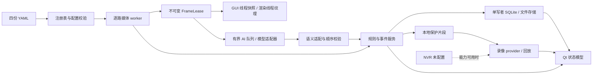

# 接口契约 v1.0.0

本工件为 InterfaceContract，面向当前六路可见光系统的后续实现、集成与验证。架构已可消费；“设计扩展”不表示源码已实现，也不表示目标设备已验证。本次只修改本目录工件与文件清单。

## 1. 依据、范围与兼容决策

源码基线为本次接手时 HEAD `a441939`（桌面实现 `a92d008`）。上游为已验证的 `docs/hmi/INTERACTION_DESIGN.md` v2、`DESKTOP_APP_DESIGN.md` v2、`VISUAL_DESIGN.md`、最新 `release/RELEASE-PACKAGE.md`。需求补充来自 `一些说明和要求.txt`，环境与授权采用本次 Runtime 注入的统一汇总。`truth/interfaces`、`truth/architecture`、`truth/requirements` 本次未列出文件。仓库无 `.codegraph/`，使用限定文件的原生阅读与 rg；未创建索引。

发布报告明确：真实六路 RTSP、真实框/掩码、真实媒体播放/缩略图未纳入发布门。既有 TEST_PASS/RELEASE_READY 保留其原范围，不能外推。设备本轮未连接、未取流、未编译、未部署。

保持 Qt5/QML 本地单进程、core/platform/media/ui 分层、原生 GStreamer UDP、CPU 渲染基线和 SQLite 表结构。这里没有新增 HTTP 服务、消息代理、远程控制通道、列车制动输出或新硬件协议。保留旧 demo CLI，但桌面程序不通过旧 demo 的可选第二路参数实现六路；历史红外、自动重启相机和云机器入口不进入本期接入。

本文件的 MUST/“必须”是后续接入的不变量；“现状”描述实际代码；“设计扩展”是需下游实现的适配边界。JSON Schema 只定义本契约的适配器描述/夹具格式，不替换现有 C++ ABI、YAML 配置或 SQLite 格式，不要求产品新增序列化链路。

## 2. 生产者与消费者

| ID | 生产者 → 消费者 | 现有入口/载荷 | 状态及设计扩展 |
|---|---|---|---|
| IF-01 | 配置目录 → 注册表/各模块 | `load_config_dir`、`ConfigLoadResult`、`CameraConfig` | 已实现；启动完整校验，错误包含字段路径；运行中配置发布待实现 |
| IF-02 | 相机 → media → UI/AI/快照 | `CameraStream::start/pump/stats/stop`、`StreamStats` | 有取流统计；没有向消费者提供图像的公开接口；新增 FrameLease/FrameDescriptor 边界 |
| IF-03 | media → core 状态/设备事件 → UI | `StreamStateMachine`、`drain_events`、`CamRuntime` | 状态机已实现；media 需公开质量/事件及真实重连结果，UI 需动态桥接 |
| IF-04 | media → 推理适配器 → 规则/调试 | `FrameRef`、`Detector::infer`、`DetectionResult`、`AiWorker` | 现有为元数据/模拟调度；新增像素租约、关联键与结果发布 |
| IF-05 | 语义适配器 → `RuleEngine` → 事件服务 | `Detection`、`on_detection/on_device_event`、`AlarmEvent` | 规则已实现；语义映射、结果顺序控制、持久化事件服务待接入 |
| IF-06 | 事件服务/操作 → platform → UI/恢复 | 九表 Row、`SqliteRepository`、`FileStore` | 存储原语已实现；业务事务、确认更新、恢复幂等待接入 |
| IF-07 | 事件服务 → 本地录像/NVR provider → 回放 | `ClipRecorder`、`RecordingSegmentRow`、`ReplayTimeline` | 本地时间戳/清单与回放逻辑已实现；实际媒体与 provider 待实现 |
| IF-08 | GUI ↔ 桥接模型 ↔ 服务 | `railhmiChannels/Alarms/Replay/Maintenance/Permissions/Health` | Qt 桥接已有；main 的实时列表为初始快照，视频层为空 Item |
| IF-09 | 健康/设备适配器 → 状态/维护/AI | `HealthSample`、`PtzState`、IntegrationRow | 业务模型已有；真实设备/采样与动作完成回报待接入 |

## 3. IF-01 配置、摄像头身份与能力

| 稳定 id | position / ai_profile | RTSP 主路径 | 凭据环境变量 | 显示目标 FPS |
|---|---|---|---|---|
| CAM-01 | primary / front | `.65:554/cam/realmonitor?channel=1&subtype=0` | TRAIN_FRONT_RTSP_CREDENTIAL | 25 |
| CAM-02 | left / none | `.160:554/h264/ch1/main/av_stream` | TRAIN_SIDE_RTSP_CREDENTIAL | 15 |
| CAM-03 | right / none | `.162:554/h264/ch1/main/av_stream` | 同上 | 15 |
| CAM-04 | roof / pantograph | `.163:554/h264/ch1/main/av_stream` | 同上 | 15 |
| CAM-05 | underfloor / wheel_rail | `.165:554/h264/ch1/main/av_stream` | 同上 | 15 |
| CAM-06 | cab / cab_door | `.167:554/h264/ch1/main/av_stream` | 同上 | 15 |

地址均为登记的 `192.168.1.x`；完整 URL 从 `app/config/cameras.yaml` 读取，表不是第二份可执行配置。注册表顺序决定 P4 稳定槽位；P1 为 left/primary/right。当前 CAM-06 `ai_enabled=true` 是配置意图，门磁/视觉方案仍未定；不能由该布尔值宣称识别能力。

摄像头全为可见光；左右 ai_enabled=false，其余为 true。`app.mode=visible`、`render_path=cpu`、`recording_source=both`。both 表示来源策略，不证明 NVR 或本地媒体已可用。前/左为文档 H265 1280×720@25；其余四路是待测预期值，正式管线以协商 caps 为准；`display_fps` 是展示上限，不能作为解码实测 FPS。

四份配置必须整体加载；缺文件/非法字段失败，缺省可选项保留 `applied_defaults`。现有枚举和小写 token 继续由 `config.cpp` 解析。设计扩展 ConfigChanged 为“校验成功的完整不可变设置 + 单调递增 revision”；先校验依赖、再交换快照，失败保持原 revision；连接参数改变仅重启受影响通道。当前没有热更新服务，不声称已支持热加载。

凭据只读取登记变量的实际值；不存在/空值返回 CREDENTIAL_MISSING，不能把变量名或 `${...}` 当密码。优先设置 rtspsrc 的认证属性，避免拼接解析串；若适配旧入口，必须正确编码 URI 和 GStreamer 字符串并只在内存中使用。原始凭据、含鉴权 URL、pipeline/bus 原文不得进入日志、DB、工件或进程命令行。`redact_url` 仅处理部分 user:pass@ URL，不能替代对整条错误消息的脱敏。

## 4. 通用字段、时钟和生命周期

设计扩展描述携带 `contract_version=1.0.0`、`origin=live|file|simulation`。simulation 必须由显式输入选择，不能用帧到达、模型名称或编译期宏猜测；生产模式缺能力返回 unavailable，不自动造数据。

跨重连帧身份为 `(session_id,camera_id,generation,seq)`：session_id 是应用启动生成的不透明字符串；generation 每次真正重建通道递增；seq 在该 generation 内严格增加。下游必须拒绝旧 session/generation、重复 seq、乱序结果；状态与时间比较也局限同一 session。持久化不把 core 自增事件 id 当跨启动唯一 id。

| 字段族 | 编码/单位 | 约束与转换 |
|---|---|---|
| `FrameRef.ts_ms` / `Detection.t_ms` / `AlarmEvent.ts_ms` / `StreamEvent.t_ms` | int64 单调毫秒 | 不得直接当 UTC 显示；FrameRef 使用接收时刻 |
| `DetectionResult.ts_ms` | int64 单调毫秒 | 头文件定义结果时刻；SimDetector 实际复制帧时刻，真实适配器须明确改用完成时刻；扩展另存 capture/result 两时刻 |
| `ts_mono_us` | int64 单调微秒 | `TimeBase.steady_now_us()`；传 core 毫秒时整除 1000；不能再当微秒重复乘除 |
| `ts_wall_ms` / 片段与回放 `t0_ms,t1_ms` | int64 UTC epoch 毫秒 | 校准后的 TimeBase 转换；UI 只在显示时采用本机时区 |
| `pts_ns` | uint64 纳秒或 null | 相机/媒体 PTS 可无效且重置，不作主机 UTC 或健康时钟 |
| 距离 / 温度 / 负载 | 米 / 摄氏度 / 百分比 | distance=-1 未知；健康字段 -1 未测，不转 0/正常 |
| FPS / 字节 / 坐标 | 帧每秒 / bytes / 原图归一化 | 计数不等于 FPS；坐标需逆 letterbox，x+w、y+h ≤1 |

启动必须 `TimeBase.calibrate(wall_ms,mono_us)` 后才能持久化带 UTC 的业务事件。公式沿用 `ref_wall_ms + (mono_us-ref_mono_us)/1000`；未校准的退化返回值不能冒充 UTC。重启重新校准；无 GNSS/NTP 实测，不声称跨设备绝对同步。时钟跳变/重新校准记录日志和映射边界，旧事件 UTC 不回写。JSON 数值均为有限数，禁止 NaN/Infinity；C++ id/seq 在 QML double 超过 2^53−1 时以字符串透传，时间毫秒在安全范围内可延续现有 double 方法。

## 5. IF-02 图像与 IF-03 流状态

现状 `CameraStream` 通过 appsink 拉取 NV12、计算亮度后立即 unref sample，公开接口仅 stats。`StreamStats.last_frame_ms=0` 表示无帧，core 内部 -1 表示无帧；桥接时显式处理这两个哨兵。`MultiStreamManager::pump_all` 顺序调用每路 pump，不能在 GUI 线程调用，更不能把它描述为六个独立取流线程。

设计扩展：media 提供 `latest_frame(camera_id)` 获取不可变 FrameLease；空返回 NOT_READY。FrameLease 持有 sample/buffer 的共享所有权或深拷贝，释放回调在最后消费者退出后执行；不能传已 unmap 的裸地址。core 仍仅见 FrameRef 元数据，像素所有权留在 media；真实模型适配入口消费 FrameLease，不能从当前 FrameRef 推导像素。

FrameDescriptor 字段见 schema：camera_id/session_id/generation/seq、capture_mono_us、capture_wall_ms、pts_ns、width/height、format、colorimetry、planes[{offset,stride_bytes,size_bytes}]、buffer_bytes、buffer_ref、memory_kind。buffer_ref 是进程内租约的不透明查找键，不能在进程外解引用；schema 不传指针、fd 或像素。v1 memory_kind=cpu，format=NV12|BGR888|RGB888；GL/DMABUF 日后必须扩充能力协商、同步和线程生命周期，不能塞进 CPU 地址字段。

NV12 必须偶数宽高，两平面 stride≥width，Y 足够 stride×height、UV 足够 stride×height/2；packed 只有一平面且 stride≥width×3，offset+size≤buffer_bytes，平面不重叠。尺寸/stride/colorimetry来自 caps，不能固定连续 width×height。未知色彩元数据标 unknown；优先复用既有 RGA BT601_FULL 基线并验证，若 caps 不同则显式转换/报告，不套用红外灰度或 RGB 均值相等验收。RGA 两个成功码均接受。BGR↔RGB 只在模型输入适配器显式转换，禁止用格式名掩盖通道颠倒。

每路采集在 media worker 有限 pull；显示 latest-only 队列深度 1；AI 按配置深度默认 2 丢最旧；录像从独立有界编码分支获取压缩包，不能复用显示丢帧策略或保存全部原始帧。溢出分别计数，录像溢出记缺口，UI/AI 慢不阻塞取流。

现有状态 token：connecting/live/frozen/offline/reconnecting/degraded。首帧超时 5000ms；live/degraded 无新帧达到 2000ms→frozen；再持续 2000ms→重连；重连退避 1000ms；累计 3 次→offline；新鲜帧恢复清零计数。source_error 可直接触发重连。以上是状态机阈值，不能冒充实际网络重建次数。degraded 有新鲜帧可展示且显式质量提示，其他非实时状态必须占位；唯一依据为 `may_present_as_live(now)`，不能只判断 state==live。

设计扩展 StreamSnapshot 增加质量 flags、最后帧 UTC/单调时间、实际 attempt_id、last_error 脱敏、presentable。状态发布不可把墙钟传入 core tick；presentable 还须租约属于当前 generation。亮度/对比度已有采样，lap_var=-1 未测，不能标为已通过清晰度检查。StreamEvent 由 media drain 到事件服务；freeze/escalated 根据 position 归类一次设备事件，重复由规则抑制。

现状 pump/tick 未实现 pipeline 重建，offline 自身不会重试。设计扩展由每路媒体控制器在退避到期重建会话（置 NULL/释放/重新建流），每个实际尝试只计一次，保留失败链计数；不能调用会清零计数的 start 伪装恢复。offline 后仍由控制器有限速率重试或人工重连；成功必须由真实新帧确认，不能由 PLAYING 返回值确认。单路失败不得重排槽位或重启其他五路。

本次执行的相机采集入口无授权，以下是下游调用边界：沿登记 RK3588 入口使用 UDP、只选择视频 RTP pad，忽略音频，不自动改 TCP/路径。元数据探测上限 20s、一次采集上限 30s；SSH 收尾不超过登记 timeout。产品单次 pull 默认≤200ms，GUI 不等待；start/重连/stop/infer 必须有调用方 deadline 与完成回报。若底层不可取消，保留资源所有权并上报超时，不能 detach/释放仍在用的内存；需要进程隔离时先补生命周期设计，不能谎报已停止。

## 6. IF-04 推理与 IF-05 语义/报警

现有 `DetectionBox` 为 x/y/w/h/confidence/class_id/label/in_roi/distance_m；`DetectionResult` 为 camera_id/profile/ts_ms/latency_ms/model_version/boxes/max_confidence，无 seq、mask、状态或跟踪 ID。`Detector.ready()` 只表达全局就绪，不表达各职责能力。`AiWorker.tick()` 当前自造帧元数据、未调用 `plan_inference`、不保存/发布 DetectionResult；虽然存在 submit/snapshot，也不能视为真实取流→规则已接通。真实路径必须关闭合成 tick，发布结果并按职责检查模型能力。

设计扩展 InferenceEnvelope 关联同一 FrameDescriptor 身份，包含 profile、capture_mono_us/result_mono_us、latency_ms（完成减接收，包含排队）、model_version、availability（ready|unavailable）、reason、boxes。每 box 在旧字段之外带 track_id（int32 或 null）；mask 以原图坐标的独立二值 plane 租约交接，像素 0/非零，尺寸/stride/所有权规则同帧，不把 RGB 掩码当 bool。mask 不经当前 core DetectionResult；语义适配器消费它后再生成 Detection。没有模型或结果时 unavailable+reason+空 boxes，不可用空框冒充已检测安全。

front 两阶段：复用轨道分割与人员检测，在原图逆变换后用人员框中心是否在 rail mask 判定；需要配置 danger_zone 时再与该 ROI 求交。分割和检测必须来自同帧同 generation；若复用缓存，需实现并登记最大年龄和失配策略，未配置禁止将跨帧缓存作为实时报警依据。分割失败不能退化成轨道内“安全”。现有分割文档输入 640×640 NHWC INT8、13 输出，后处理 `for (i<13)`；真实加载必须查询 tensor 数量、形状、布局、量化并匹配后处理后才 ready，不能只按文件名判断。

既有 yolov5s 仅 COCO person；轨道分割不等于轮轨脱离识别；相同模型挂到 pantograph/cab_door 不会获得语义能力。职责能力需适配器声明并核验，模型版本字符串仅身份。障碍物/树枝/碎石、受电弓三态、轮轨、车门专用语义未获现有模型证据；未支持时该职责 unavailable。测距未标定时 distance_m=-1，不用检测框尺寸臆造米值；`danger_proximity_m` 当前规则并未消费，不能写成已实施的 5m 风险门槛。

语义映射必须严格：front 只把支持的 person/obstacle 传 RuleEngine；未知 label 被拦截（当前规则会把非 person 都归障碍）。pantograph 传 unknown/not_raised/normal/abnormal；wheel_rail 传经标定语义的 wheel_abnormal；cab_door 传 unknown/closed/ajar。左右 none 永不产生检测类报警。unknown 不映射到正常。跟踪未就绪时 frame track_id=null；不能直接把所有目标映射 track_id=0 累计三次误认同一目标，须提供跟踪或显式的已验证相机级事件适配。

规则保留现有级别：person_on_rail/front_obstacle/wheel_derail=L1；pantograph_abnormal/door_ajar/front_camera_device/device=L2；side_camera_device=L3。on_detection 按 `(camera,type,track_id)` 抑制，默认 3 次确认，相邻命中间隔≤500ms，抑制窗口 `<3000ms`。注意现有实现判断相邻间隔而不是三帧总跨度；0/400/800ms 会确认，这一语义原样记录，若需求要求总窗须交实现修复后版本化，不在本次架构悄改。

每次命中只处理一次；同帧多目标先聚合并按稳定 track 排序，不能让无关非候选调用任意清除同相机确认（现有 reset_camera_confirm 清除整路）。失帧/新 generation 清理确认与跟踪；现有 RuleEngine 无公开 reset，需实现者补受控接口。抑制期间 on_detection 返回空但会更新已有事件元数据，事件服务需同步变化，不能仅消费新返回数组。确认仅 ack_state，不删事件，不重置故障/AI 可用性。

推理默认每 5 帧，front>wheel_rail>pantograph>cab_door，npu_budget=4 是调度路数预算而非 NPU 核数或通过的算力容量；85°C 热守卫由 scheduler 定义，真实工作线程须接入决策与实测温度，不能拿模拟 FPS/温度冒充能力。真实 infer 不得持调度锁阻塞 submit/状态快照/stop；结果队列有界，超载显式丢旧并发布计数。AI 不可用不影响视频显示。

## 7. IF-06 事件、数据库和文件一致性

沿用九表 `events,event_targets,maintenance_log,device_health,recording_segments,recording_gaps,stream_events,integrations,config_kv`；Row 字段以 `persistence_model.h` 为准，不在本次改 DDL。EventRow 保留 level/type/source_cam/ai_profile、UTC毫秒/单调微秒、confidence/distance_m/algo/model_version/description/ack_state/record_available/snapshot_ref。EventTargetRow 的 first_ts/last_ts 本契约适配层统一写 UTC毫秒，boxes_json 用原图归一化框；现有历史数据无显式单位者不猜测迁移。

事件服务是唯一业务写入口，单写线程持有 SqliteRepository；现有 open 使用 WAL、foreign_keys=ON、synchronous=NORMAL、busy_timeout=5000ms。DB 操作不得在 GUI 线程阻塞。insert 返回 -1 或 bool=false 时必须保留错误，不能当空结果。SQLite rowid 为正式事件 id；core AlarmEvent.id 只在本次引擎实例有效，适配层保存 engine→DB id 映射。事件与目标写同一事务；确认与审计同一事务，ack 重试幂等。当前 Repository 缺事件更新/ack/列表查询和业务事务 API，列为下游实现依赖，不能称已持久确认。

写前按采集时刻校准 UTC；algo/model_version/ai_profile 来自实际结果来源，不能用配置名称覆盖运行时模型身份。现有 stream 单调 ms 需乘 1000 转 ts_mono_us，再经已校准 TimeBase 转 UTC。跨进程恢复只依据 UTC 查询，不跨启动比较 ts_mono_us。

文件先写同目录临时文件，再完成媒体封装/校验、flush+fsync 文件、rename、fsync 目录，然后事务发布可用索引。现有 FileStore 只有 ofstream.flush+rename，没有 fsync；SQLite NORMAL 也不保证最近事务抗断电，本次不声称断电持久性已通过。文件失败不置 record_available=true；索引失败保留可恢复孤儿及日志，启动核对临时文件/孤儿/缺失文件，缺失写 gap 或 unavailable。存储重试最多在剩余 deadline 内有限次数，不能无界内存堆积或吞错。

保留策略遵循现有普通片段先淘汰、必要时最旧保护片段仍可淘汰；保护不是永不删除。容量 max_gb 与实际 free bytes 分开，换算口径实现前固定并登记，不把 max_gb 当磁盘可用；低空间阻止新写并报警，事件元数据/缺口尽可能保留。删除/失败同步更新片段索引和事件录像可用性，不能残留播放成功标记。

## 8. IF-07 录像、回放与 NVR

设计扩展 ClipRequest：request_id/event_id/camera_id/trigger_wall_ms/t0_wall_ms/t1_wall_ms，其中 t0=trigger−pre×1000、t1=trigger+post×1000；默认 −30s/+60s，来源为 thresholds.yaml。event_id 是已提交 DB id；request_id 是幂等键，相同键不同参数 CONFLICT，重复相同请求返回同一作业。前方事件请求相关 left/primary/right 三路（各路独立报告缺口），其他事件请求来源路；六路预缓冲与写盘量需实测，不能由时间戳 buffer 推断存在媒体。

内部实际媒体区间采用 `[t0,t1)`；RollingBuffer.count_in 现有闭区间保留在逻辑模型中，适配时边界只映射一次，避免拼接重复末帧。压缩流以关键帧解码依赖决定实际起点，回报 actual_t0/actual_t1 与请求窗口；不得用期望的 90s 覆盖缺失前录/后录。缺口按 camera/time/reason 存储；部分可播放标 Incomplete，无片段标 Unavailable。现有 bool record_available 仅兼容完整可用 true，不足表达三态；UI 使用 RecordAvailability 和片段/gap 联合推导。当前 P2 的 camera级 record map 需升级为事件时间窗级计算，不能因为同路其他录像存在而误标所有事件。

现状 ClipRecorder 只存时间戳、生成 JSON 清单/估算大小，finalize 不证明 MP4/TS 可解码。provider 必须以真实可读/可定位/可解码媒体和实际覆盖范围返回 usable。禁止把 .json 清单、空文件、路径存在或估算 size_bytes 当录像。

IRecordingProvider 设计扩展保持上游方法族：querySegments(camera,t0,t1)、queryGaps、playSegment、exportSegment。每次带 request_id 与 deadline_mono_us，返回 status=ok|partial|unavailable|error、reason、segments、gaps，不可用原因区分 UNCONFIGURED/UNVERIFIED/NOT_FOUND/AUTH_FAILED/TIMEOUT/UNSUPPORTED/STORAGE_ERROR。ok 空列表仅表示查询成功无覆盖，不能声称可播放。play/seek 是异步请求，回报实际 decoded position；请求接受不等于播放成功。导出返回实际完成路径/大小或失败，部分覆盖需显式 partial。

NVR 登记地址 `.4`，协议/账户/六路映射/管理入口缺失：state=unconfigured、query 返回 unavailable/UNCONFIGURED；不探测未知协议、不猜通道号、不修改 NVR。将来实现 NvrProvider 前补环境登记与授权、厂商协议/鉴权/时间轴及通道映射；架构只定义抽象。`reachable` 仅网络可达，不能等价回放支持。NVR 不可用时仅在本地对应窗口有真实片段才回退，否则 unavailable；不生成模拟片段填补。

P3 保留 selectAlarm(camera_id,ts_wall_ms)、relatedCameras、timeline(camera,date)、四跳转、playback/setPlaying/setSpeed、sourceStatus、syncState。selectAlarm 在未来增加 event_id 的非破坏重载，旧 camera+ts 遇多事件须明确歧义。前方默认左/前/右；时间轴 UTC、日期显示按本机时区且标明转换，不能混用 UTC日与本地日。

同步按各路实际解码播放头的统一 UTC 时间求 max−min，超过 300ms（可配）提示；缺任一路有效时钟 available=false。现有 setCameraOffsets 是模型注入接口，不能以固定 offsets 代替真实播放头。用户 seek 递增 request generation，丢弃旧完成回调；position 未到达不能提前显示“已定位”。缩略图只用媒体生成的可读引用；thumbSource 缺基址继续返回空，不编造 URL。

## 9. IF-08 Qt 桥接与 IF-09 维护/健康

保持现有上下文名与 QVariantMap camelCase；core snake_case 只在桥接层转换。railhmiChannels 每格键保持 id/name/position/badge/aiEnabled/slot/state/stateLabel/fpsText/lastFrameText/reconnectText/presentable/placeholder；aiDebug 保持 cameraId/profile/modelVersion/available/unavailableReason/fpsText/latencyMs/lastResultText/confidenceText/distanceText/boxes/roi。DetectionBox.distance_m→distanceM；数值未知值不格式化为0。

设计扩展由 QObject/QAbstractListModel 在 GUI 线程更新快照与 notify，worker 通过 queued connection 送不可变消息；纹理创建/销毁在 Qt 渲染线程；模型更新不能在每次取帧无限追加信号，可合并 latest。P1/P4/P5 共享同一帧来源与状态真值，切页不另拉流/不重置媒体服务；P1 司机不显示 AI 调试叠加与检测徽标，P5 权限由 core 控制。保留既有 changed/selectionChanged/playbackChanged 信号语义，运行时刷新需实际接线。

动作边界在服务端重新调用现有 permissions gate，不依赖 QML 隐藏按钮。exportRecording/modifyConfig/PTZ 等敏感动作需权限+二次确认+审计，再发真实请求。设计扩展 ActionReply 区分 accepted/completed/failed、request_id、reason；accepted 不能当 completed，超时 unknown 需先查状态不能盲目重试副作用。confirm 仅用户交互凭据，不是设备执行成功；角色配置不是新增鉴权系统。本能力不实现登录或改变权限矩阵。

PTZ 模型 PtzState/容差与 ptzAction/reconnect 保留；现有 action 只是模型/日志，不是设备命令。可支持的 HTTP/ONVIF 地址、鉴权、Pan/Tilt单位/量程、zoom比例、home/preset token、实际位置查询及完成标准需由当前设备协议证据补齐；历史脚本只作参考，无活动入口时返回 UNSUPPORTED/UNCONFIGURED，不猜0..1/角度单位。前方 AI 必须基于有效实际值/容差检查才就绪，不能用 target填actual；未知/超差显示 NOT_READY。自动重启相机不是本期默认恢复行为。

health 采样声明 npu/cpu 为0..100百分比、temp_c摄氏、disk bytes、net_errors累计计数；读不到用-1或明确 unavailable，不填固定演示值。main 当前无条件 seed 健康样例与成功恢复序列，即使 simulation=false；真实接入必须改用采样/真实步骤结果，不能拿其“正常”当设备通过。门磁、车速/GPS、声音输出未提供协议/设备事实，保留未接入；不新增接线、串口/CAN或蜂鸣器指令。

## 10. 统一错误、重试与版本

新适配器错误用稳定 reason token + 已脱敏 detail + camera/request 关联；既有 bool/err、id=-1 由适配器归一，不改其签名。配置错误 INVALID_CONFIG、凭据缺失 CREDENTIAL_MISSING/鉴权 AUTH_FAILED 不自动反复重试；等待配置/凭据变更或显式操作。网络 TIMEOUT/SOURCE_ERROR 可按逐路退避重试；格式/模型 UNSUPPORTED/MODEL_MISMATCH/NOT_READY 仅在输入或模型能力变更后重试。取消返回 CANCELLED；旧 generation 返回 STALE；重复参数不一致 CONFLICT。读操作可重试，带副作用请求须幂等或查询结果后再决定；错误时记录下一动作与重试计数，不改 permissions.yaml 授权。

新增接口版本为适配器版本 1.0.0，与产品 0.1.0 分开。消费方支持同 major 内已知字段，可忽略新增可选字段；unknown state/reason 显示不可用并记录，不按正常默认。删除/重命名字段、单位/哨兵/坐标/时序变化需 major 升级；新增必填字段同样 breaking。固定 v1 schema 故意关闭 additionalProperties 以捕获夹具拼写错误；演进时必须更新 schema+兼容矩阵，生产适配器可以忽略同 major 的可选字段。

无 SQLite user_version 迁移实现证据；未来迁移要显式版本、事务、备份与回滚兼容性检查，不清库重建。现有四份 YAML 不额外添加 contract_version 必填项；新增配置可选并记录默认。当前 C++ 静态库内部类型不承诺二进制跨版本兼容，更新接口后重编所有消费者。

## 11. 下游交接与可检验不变量

| 依赖 | 实际证据 | 下游完成条件（本次未代实现/代验证） |
|---|---|---|
| D-01 像素与视频呈现 | camera_stream 拉 sample后 unref；VideoSurface 空 videoLayer；main 初始 chanList | 租约生命周期、stride、GUI更新/纹理接线、逐路真实帧与故障恢复 |
| D-02 重连 | pump 只有 tick、无重建；offline无自动转换 | 有界重建，实际attempt与状态一致，单路失败隔离 |
| D-03 真实推理 | FrameRef无像素，tick自造帧，不发布结果/不调用scheduler | 模型能力就绪、同帧关联、受控调度、真实结果到语义/规则 |
| D-04 语义与顺序 | 非person皆障碍、camera级reset、track缺失 | 受支持标签白名单、稳定跟踪、多目标/重复/乱序/跨重连隔离 |
| D-05 持久事务 | Repository无业务更新接口；FileStore无fsync | 正式id、ack审计事务、恢复幂等、真实断电语义证据 |
| D-06 录像/回放 | 时间戳buffer/清单、模型游标，无真实媒体 | 实际视频、关键帧边界/缺口、播放时钟、事件级可用性 |
| D-07 状态与动作真值 | main健康样例无simulation守卫；维护动作是模型 | 真实采样/恢复进度、请求完成回报、权限和错误路径 |
| D-08 外部未知 | NVR protocol/map空、PTZ接口/测距/专用模型未确立 | 配置与协议证据补齐后接入；未知状态保持不可用 |

配套 [interface.schema.json](interface.schema.json)、[examples.json](examples.json)、[validate_contract.py](validate_contract.py) 可由实现和验证方直接复用；[VALIDATION.json](VALIDATION.json) 保存本次检查、源码位置、输入哈希、版本与未执行项。从仓库根目录运行 `python docs/interfaces/validate_contract.py --output docs/interfaces/VALIDATION.json`，仅需已有 PyYAML/jsonschema，不连接设备、不运行产品。检查配置漂移会如实失败，不能通过修改产品配置或降低断言掩盖差异。

设计与夹具向量覆盖同 generation 帧、带 padding 的 NV12、重复/旧结果、500ms相邻窗、3000ms抑制边界、UTC与单调换算、缺口/部分回放、NVR未配置和未知模型；三命中是否真正生成报警仍需下游运行 RuleEngine 验证。必须分别取得源码单元验证、板端集成、真实六路负载与人工视觉证据；schema/static PASS 仅证明本契约夹具与已核对基线一致。

验收不变量：INV-01 无凭据泄露；INV-02 旧帧不当实时；INV-03 身份/时钟/单位不混用；INV-04 未支持模型/未知状态不当正常；INV-05 左右不检测且级别保持；INV-06 确认不删除事件且可恢复；INV-07 清单不当视频/缺口不隐藏；INV-08 部分同步不当三路成功；INV-09 GUI无阻塞设备调用；INV-10 一次能力失败不扩入口/权限/产品范围。
